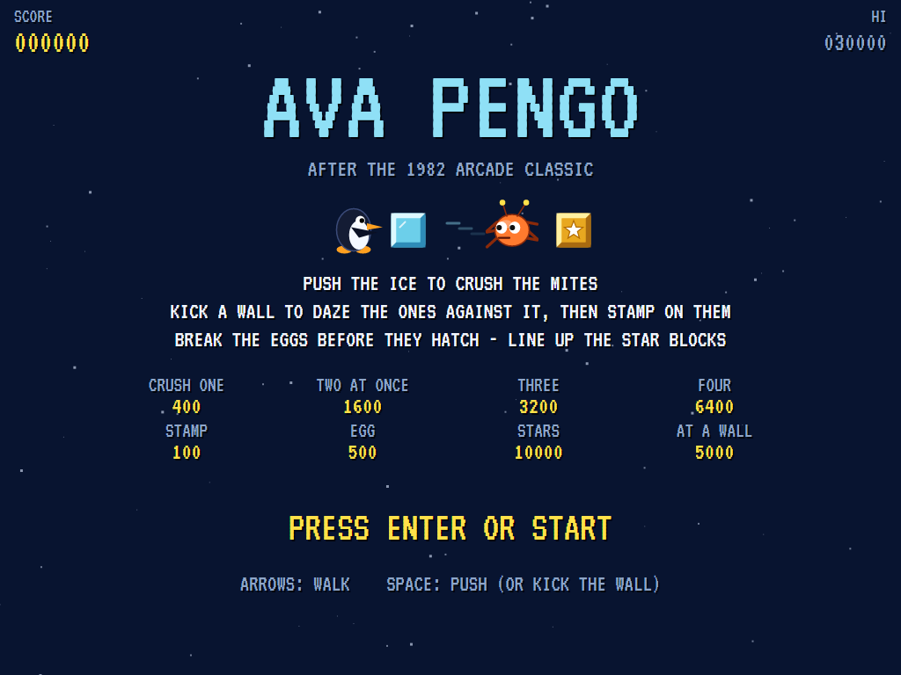
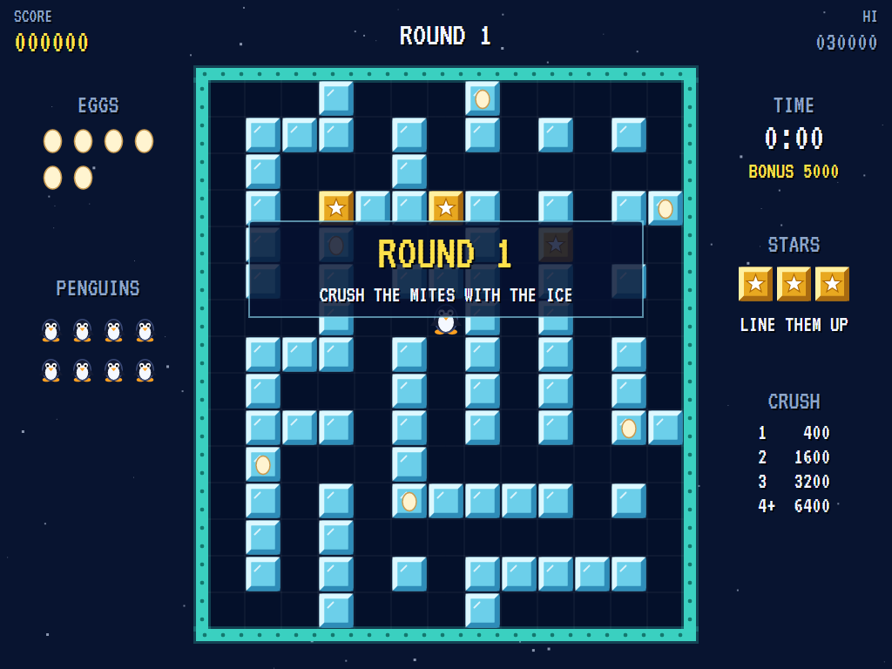
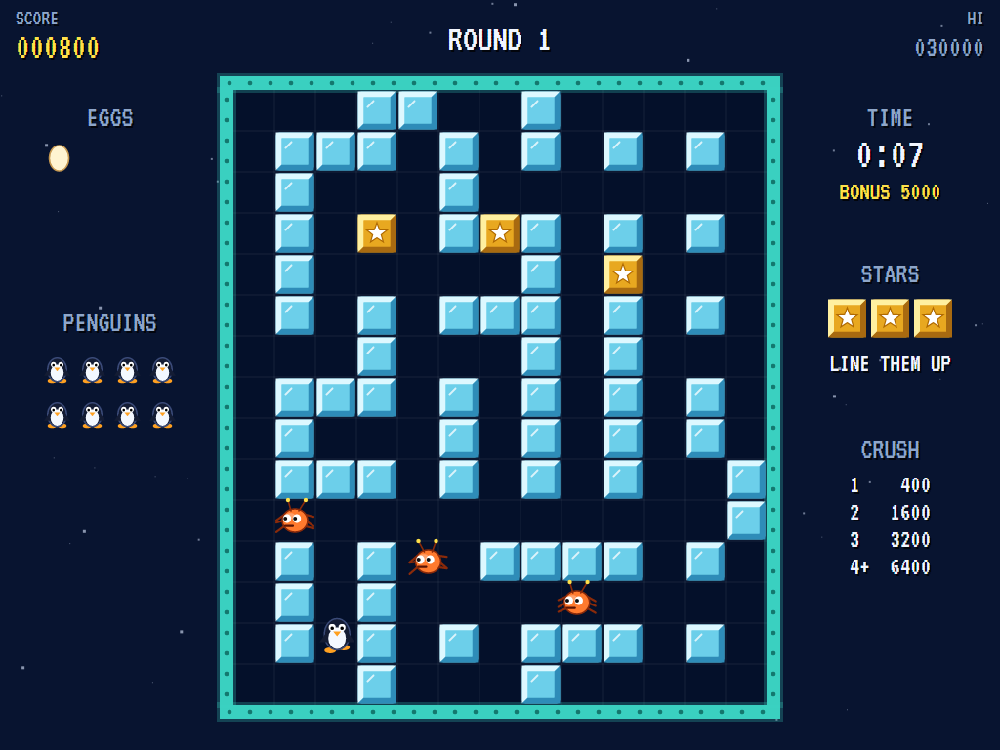
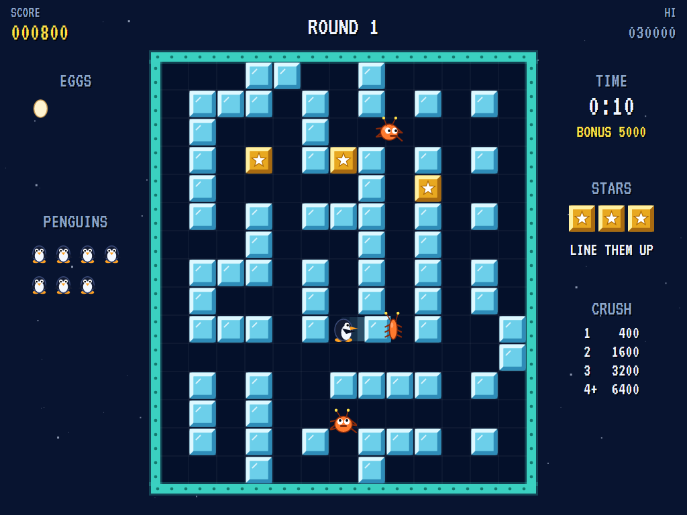
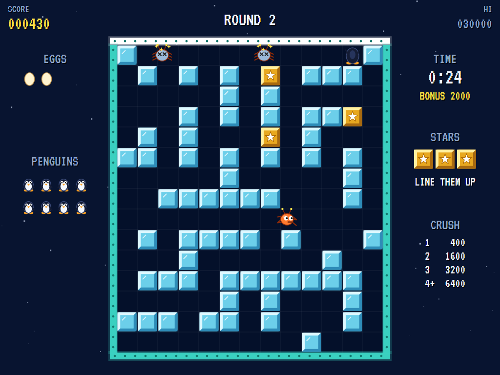
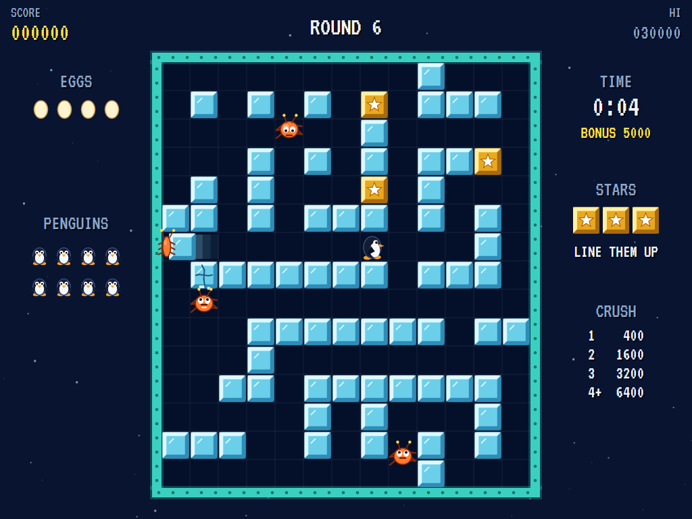
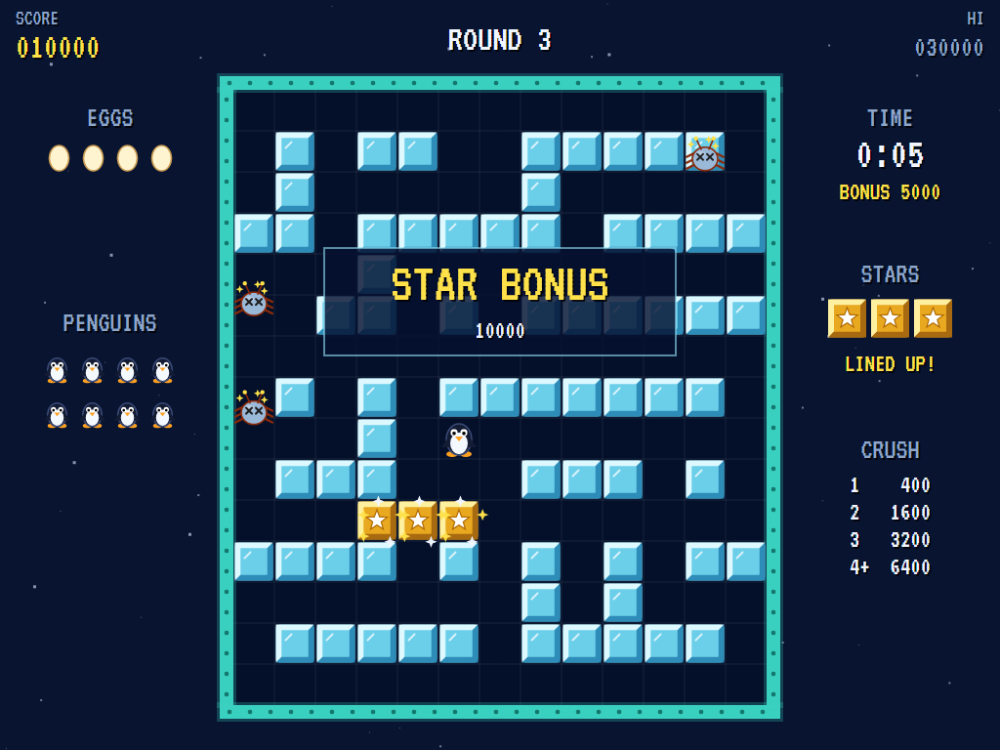
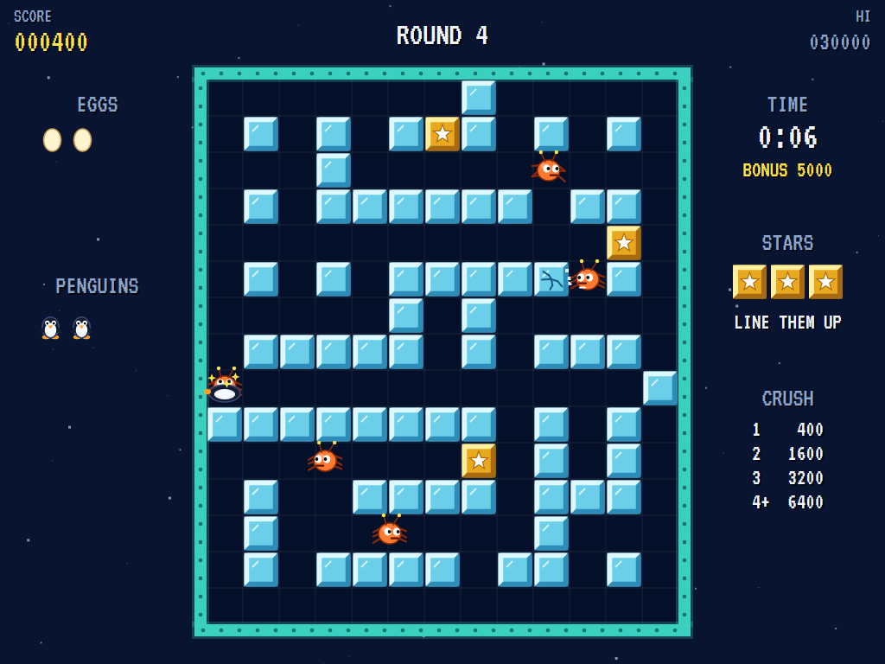
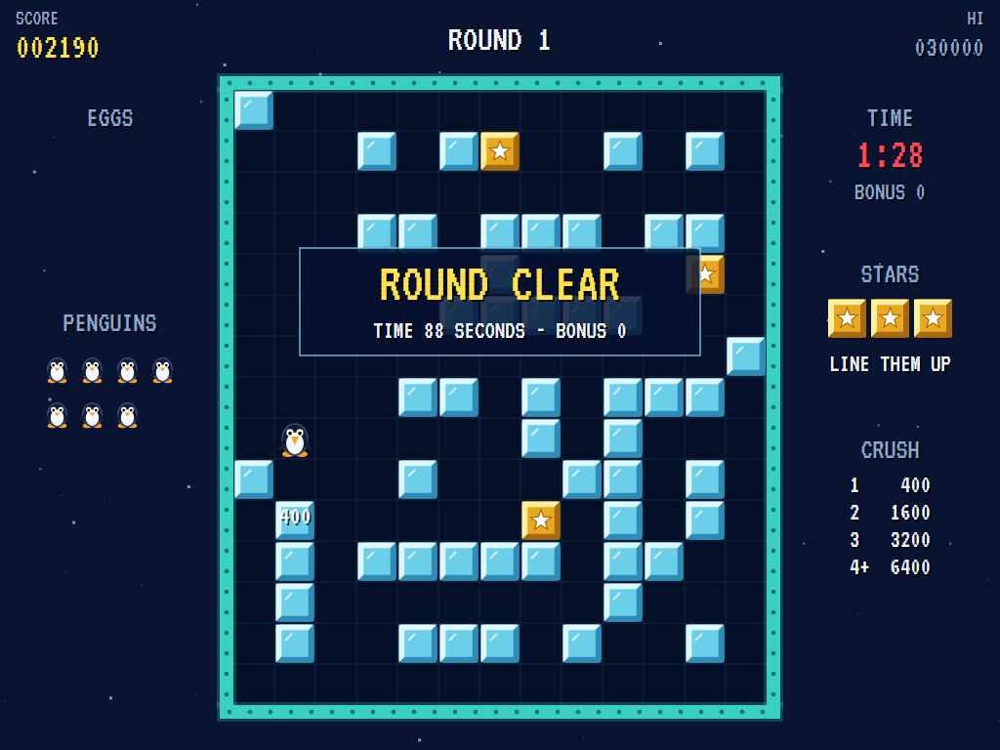
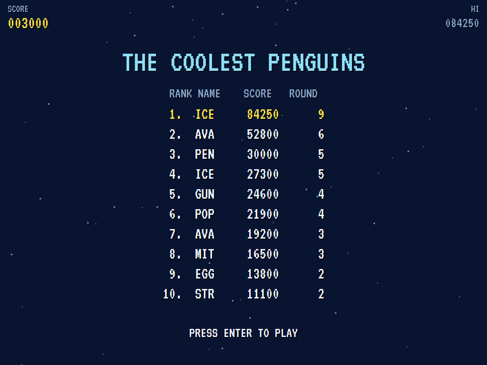

# AVA Pengo

[](https://github.com/Harlock123/AVAPengo/actions/workflows/build.yml)

An ice-block maze game in the style of Sega's 1982 arcade game **Pengo**, built with .NET 10 and Avalonia
UI. A penguin shares a field of ice blocks with a swarm of mites that want to catch it. Kick the blocks
and they slide off across the ice, squashing any mite in their way. Kick a wall and every mite against it
is left seeing stars. Break the eggs before they hatch, and line up the three star blocks for a big bonus.

## Features

- **The field**:
  - **The maze:** every round's field is a new maze cut through solid ice, thirteen blocks by fifteen, with walls all round.
  - **What every cell can be:** a block of ice, one of the three star blocks, or open.
- **The penguin**:
  - **Walking:** it walks from cell to cell, and turns to face a block it can't walk into.
  - **Pushing:**
    - A block with room behind it slides away until something stops it. Any mites in its way are carried along and crushed when it stops.
    - A block with no room behind it breaks. Star blocks never break.
  - **The walls:** push against a wall and it shakes, leaving every mite against it dazed for a few seconds. Walk into a dazed mite to stamp on it.
- **The mites**:
  - **Eggs:** every mite starts out as an egg hidden in the ice. The eggs show for a moment at the start of each round, and the panel on the left counts those still to hatch.
  - **Hatching:** a few mites are about at once. When one is crushed, another hatches out of the ice somewhere, harmless for a moment as it wriggles free.
  - **Breaking eggs:** break an egg's block to stop that mite before it hatches.
  - **Hunting:** they hunt the penguin through the maze, and chew their way through the ice when they can't get round, or don't care to. A block being chewed cracks more and more.
  - **Hurrying:** after a minute they hurry.
  - **The last mite:** it panics and runs for a corner. Let it get there and it's gone, but the round still ends.
- **The star blocks**: push the three star blocks together in a row or a column for a bonus of 10,000 (5,000 if any of them touches a wall). Every mite is dazed as well. You get one star bonus a round.
- **Scoring**:
  - Crushing mites with one block: 400 for one, 1,600 for two at once, 3,200 for three, 6,400 for four
  - Stamping on a dazed mite 100, breaking an egg 500, breaking a block of ice 30
  - **The time bonus:** a round cleared in under 20 seconds earns 5,000. It drops to 2,000 under 30, 1,000 under 40, 500 under 50, and 10 under a minute.
  - **Extra penguins:** one at 30,000, then every 50,000 after that.
- **Sound**:
  - **The music:** a bouncy new tune for the rounds and a music-box waltz for the title. Pengo's own famous tune isn't used.
  - **The effects:** pushes and slides, blocks coming to rest and breaking, crushes, the wall's buzzing wobble, eggs cracking and hatching, chewing, the star fanfare, the hurry-up alarm and the last mite's dash.
  - All of it is synthesised and mixed by OpenAL.
- **Attract mode**: leave the title alone for 15 seconds and a computer penguin plays.
  - It weighs up everything it could do from every cell it can safely reach: send a block down a corridor with mites in it, break an egg, kick a wall with mites against it, stamp on a dazed mite, or line up the star blocks.
  - It goes for the best of these, allowing for the walk there, and backs away from a mite it has nothing to hit with.
- **A top-ten high-score table** with arcade-style initials entry. It records the round reached.
- **Gamepads** through SDL2, as well as the keyboard.
- **Any window size**: the screen scales to fit, letterboxed. **Ctrl+S** saves a screenshot.
- **One self-contained executable** per platform: Windows, macOS and Linux on Intel/AMD and ARM.

## Screenshots

| The title | Round 1 | On the ice |
|:---------:|:-------:|:----------:|
|  |  |  |
| What everything is worth. | The eggs show through the ice. | Three mites on the loose. |

| Crushed | Dazed | Chewing |
|:-------:|:-----:|:-------:|
|  |  |  |
| A mite carried off by a block. | A kicked wall, and two mites seeing stars. | A mite eating its way through. |

| The star bonus | Caught | Round clear |
|:--------------:|:------:|:-----------:|
|  |  |  |
| Three in a row. | Flat out. | The time bonus. |

| The coolest penguins | | |
|:--------------------:|:-:|:-:|
|  | | |
| The high-score table. | | |

The screenshots are made by the tests, which play the game in a real (headless) window; see
[Tests](#tests).

## Download and run

Ready-to-run builds for Windows, macOS and Linux, on both Intel/AMD and ARM, are on the
[Releases page](https://github.com/Harlock123/AVAPengo/releases/tag/latest). **Latest build** is rebuilt
on every push to `main`. Each download is one self-contained executable: no .NET install is needed.

| Platform | Archive |
|---|---|
| Windows | `AVAPengo-win-x64.zip`, `AVAPengo-win-x86.zip`, `AVAPengo-win-arm64.zip` |
| macOS | `AVAPengo-osx-arm64.tar.gz` (Apple silicon), `AVAPengo-osx-x64.tar.gz` (Intel) |
| Linux | `AVAPengo-linux-x64.tar.gz`, `AVAPengo-linux-arm64.tar.gz`, `AVAPengo-linux-arm.tar.gz` |

```bash
tar -xzf AVAPengo-linux-x64.tar.gz     # or linux-arm64, linux-arm, osx-arm64, osx-x64
./AVAPengo
```

On Windows, unzip and run `AVAPengo.exe`. On macOS, if Gatekeeper refuses to open it, run
`xattr -d com.apple.quarantine AVAPengo` once. Run with `--no-audio` for silence.

**Sound** comes through OpenAL Soft, built in for every platform. In a virtual machine the game
detects it and uses a larger audio buffer, so the sound doesn't break up.

**Gamepads** use SDL2, which is bundled for Windows, macOS and Intel/AMD Linux. ARM Linux builds need it
installed; without it the keyboard still works:

```bash
sudo apt install libsdl2-dev            # Debian / Ubuntu / Raspberry Pi OS
sudo pacman -S --needed sdl2-compat     # Arch / Omarchy
```

## Controls

| Input | Action |
|-------|--------|
| **Enter** | Start |
| **Arrow keys** / **W A S D** (or the numeric keypad) | Walk; against a block or a wall, turn to face it |
| **Space** / **Z** / **X** / **Ctrl** | Push the block in front (or kick the wall) |
| **P** / **Esc** | Pause (Esc again to quit) |
| **M** | Mute |
| **Ctrl+S** / **Cmd+S** | Save a screenshot to the Pictures folder |

**Gamepad**: left stick or D-pad to walk, **A**, **B** or **X** to push, **Start** to start and pause,
**Back** (while paused) to quit.

**Entering initials**: type letters, or dial with **Up**/**Down** and accept with **Space**; **Left** /
**Backspace** go back; **Enter** finishes.

## Tests

```bash
dotnet test AVAPengo.slnx
```

The engine has no UI and runs in fixed 60 Hz steps, so it plays the same at any frame rate, and a seed
always plays the same game. The tests check:

- **The field:** every one a maze joined up from the middle, with three star blocks apart from each other and the walls, an egg for every mite, and the same every time
- **The penguin:** walking cell to cell and stopping when let go, and turning to face the ice that stops it
- **Pushing:**
  - blocks sliding until something stops them
  - blocks with no room breaking, but never star blocks
  - eggs broken for 500
  - mites crushed, more for more at once, even one coming down the corridor
- **The walls:** a kick dazing the mites against it, stamping on them, and their coming round
- **The mites:**
  - hunting the penguin down, the next penguin back in the middle with the mites sent away, and the last penguin ending the game
  - harmless while hatching
  - chewing out through the ice
  - the eggs hatching to keep them coming
  - the last one running for a corner
  - hurrying after a minute
- **The round:** the time bonus, and the star blocks lined up (in the open, and against a wall)
- **The machine:** extra penguins, the computer penguin clearing the first rounds, the attract cycle, the same game from the same seed, initials and the high-score file

The screenshot tests draw the real screen in a headless window. To refresh the README's pictures:

```bash
PENGO_SHOTS=$PWD/Images dotnet test tests/AVAPengo.Tests --filter ScreenshotTests
```

To see how the computer penguin gets on, round by round (for tuning), or how a player who just wanders
about pushing does (`PENGO_PROBE=lazy`):

```bash
PENGO_PROBE=1 dotnet test tests/AVAPengo.Tests --filter PilotProbe --logger "console;verbosity=detailed"
```

## Building

```bash
dotnet build AVAPengo.slnx
dotnet run --project src/AVAPengo
```

Needs the .NET 10 SDK. The sounds are made by `tools/make_sounds.py` (standard-library Python):
`python3 tools/make_sounds.py` rewrites `src/AVAPengo/Sounds`.

## Project structure

```
AVAPengo/
├── AVAPengo.slnx
├── src/AVAPengo/
│   ├── Engine/
│   │   ├── GameEngine.cs        # States, the title and demo cycle, and the music
│   │   ├── GameEngine.Play.cs   # The penguin, pushing, sliding and breaking blocks, the walls, the mites
│   │   │                        # and their eggs, the star blocks, the time bonus and scoring
│   │   ├── Board.cs             # Each round's ice maze, its eggs and star blocks; distances
│   │   ├── PenguinPilot.cs      # The computer penguin, for the demonstration (and the tests)
│   │   ├── Entities.cs
│   │   ├── HighScoreTable.cs, InitialsEntry.cs
│   │   ├── InputHandler.cs, ControllerManager.cs  # Keys and an SDL2 gamepad
│   │   └── SoundManager.cs      # Effects and the tunes through OpenAL
│   ├── Audio/                   # The OpenAL engine (from the author's AVABand)
│   ├── Views/                   # The ice field, the penguin and the mites, the panels, the screens
│   └── Sounds/                  # The synthesised effects and tunes
├── tests/AVAPengo.Tests/        # Gameplay, screenshot and probe tests
├── tools/make_sounds.py
└── Images/                      # Screenshots
```

## About and licence

AVA Pengo © 2026 Lonnie Watson, under the [MIT License](LICENSE).

*Pengo* © 1982 Sega; the name belongs to its current owner. AVA Pengo is an independent, unofficial game
in its style. Its penguin, its mites and their eggs, its star blocks, graphics, sounds, tunes and code are
its own; nothing is taken from the arcade machine's program, graphics, sound or music. It is not
affiliated with or endorsed by any rights holder.
